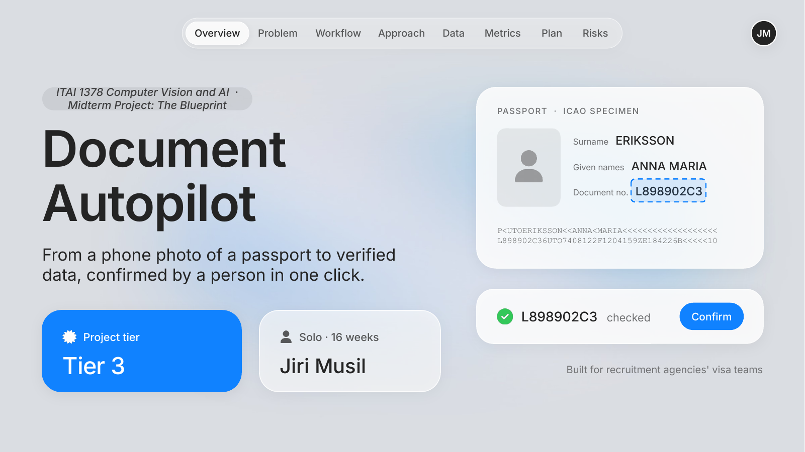

# Document Autopilot



> Reads a phone photo of a passport or ID card, shows exactly where every value is printed, checks it, and lets a person confirm it in one click.

**ITAI 1378 Computer Vision and AI · Midterm Project: The Blueprint** · Slides: [`docs/proposal.pdf`](docs/proposal.pdf) · Data plan: [`data/README.md`](data/README.md) · AI usage: [`docs/AI_usage_log.md`](docs/AI_usage_log.md)

## Team Members
- Jiri Musil (individual project)

## Project Tier
Tier 3: this is a production-style system a company could pilot, chaining five AI models and rule checks from photo to a review app real staff can use.

## Problem Statement
Recruitment agencies that place workers in jobs abroad receive phone photos of passports and ID cards, often blurry, tilted or glared, and their visa and immigration officers retype every name, number and date by hand. Nothing checks that typing: one wrong digit in a passport number or expiry date can send a visa application back, and expiry reminders only work if the date was typed correctly. Plain OCR is not the answer: on the public MIDV-2020 benchmark, Tesseract 4 read only 10.5% of passport code lines (MRZ) fully right.

## Solution Overview
Document Autopilot turns a phone photo of a passport or ID card into confirmed, checked data. It finds and straightens the document, identifies its type, reads the machine-readable code lines with their check digits, reads the printed fields with OCR and a small vision-language model, and proves every value by re-reading its box with a second engine. A review screen shows each value beside the crop where it is printed, and nothing is saved as true until a person confirms it in one click.

```mermaid
flowchart LR
  A[1 Phone photo] --> B[2 Photo check<br/>blur, glare, cut-off]
  B --> C[3 Find and flatten<br/>4 corners]
  C --> D[4 Identify type<br/>or unknown]
  D --> E[5 Read code lines<br/>MRZ + check digits]
  E --> F[6 Read printed fields<br/>OCR + VLM, box per value]
  F --> G[7 Double-check<br/>2nd engine + date rules]
  G --> H[8 Review screen<br/>value beside its crop]
  H --> I[9 Confirmed record<br/>JSON + who confirmed]
```



## Technical Approach
- CV Technique: Multi component: detection (document corners), classification (document type), OCR (text detection + recognition) and a VLM for missing fields
- Model Architecture: CNN (corner detector, type classifier), CNN + Transformer hybrid (OCR), VLM with a ViT encoder (field filling), Vision Transformer (second-engine re-read)
- Model: YOLO11n-pose, EfficientNet-B0, PP-OCRv5, PaddleOCR-VL-1.6 (0.9B), docTR (PARSeq)
- How we will use it: transfer learning for the corner detector and the type classifier; the OCR, the VLM and the re-reader pretrained as is; all open source, no APIs
- Framework: PyTorch, Hugging Face Transformers, PaddleOCR, OpenCV, Gradio
- Why this approach: an ID mixes exact code lines with free text in many alphabets, so no single model reads it safely. The exact readers run first, the VLM only fills gaps, and a second engine proves every value; in the [early notebook](notebooks/00_mrz_check_digits.ipynb), check digits caught 100% of wrong digits but only 92% of wrong letters in 10,000 simulated misreads.

| Step | CV technique | Architecture | Model (open source) | How I use it |
|---|---|---|---|---|
| Find and flatten the page | Detection: 4 corner keypoints | CNN | YOLO11n-pose (Ultralytics) | Transfer learning on MIDV-2020 corner labels |
| Identify document type | Classification: 10 types + "unknown" | CNN | EfficientNet-B0 (timm) | Transfer learning |
| Read printed text | Text detection + recognition (OCR) | CNN + Transformer hybrid | PP-OCRv5 (PaddleOCR 3) | Pretrained as is, one model per alphabet |
| Fill missing fields with a box | Vision-language model (VLM) | ViT encoder + small language model | PaddleOCR-VL-1.6, 0.9B | Pretrained as is, fixed field list, JSON out |
| Double-check every value | OCR re-read of each crop | Vision Transformer (PARSeq) | docTR | Pretrained as is |

No-AI parts: photo checks (OpenCV), MRZ check digits (ICAO Doc 9303), date rules, confidence calibration (scikit-learn), review app (Gradio).

## Dataset
- Source: MIDV-2020, a free public benchmark of mock identity documents (fake people, generated faces), plus 5,000 synthetic MRZ lines, the ICAO Doc 9303 specimens, and MIDV-500 document types held out to test "unknown"
- Size: MIDV-2020 has 1,000 unique mock documents and 72,409 labelled images (1,000 templates, 1,000 photos, 2,000 scans, 68,409 video frames); I use about 13,000 (all photos and scans + 10 frames per clip), split by document 700 / 150 / 150. That means downloading 5 of the 8 archives (17.4 GB of 124 GB) and keeping a working set of about 9 GB
- Labels: already exist (document type, 4 document corners on every image, exact value and box of every text field, MRZ lines on the 4 passport types); I only script field boxes onto each photo through its corners and spot-check 50
- Link: paper https://arxiv.org/abs/2107.00396 · download ftp://smartengines.com/midv-2020/ (anonymous FTP, reachable on 2026-10-09) or the La Rochelle mirror after its access form, https://l3i-share.univ-lr.fr/MIDV2020/midv2020.html · licence CC BY-SA 2.5 (details in [`data/README.md`](data/README.md))

## Success Metrics (what we will measure and expect)
- Primary: we will measure exact-match accuracy of the five critical fields (document number, surname, given names, birth date, expiry date) on the photos and scans of the 150 unseen test documents, and expect at least 95%, reported per document type, alphabet and photo condition. Baseline for comparison: Tesseract alone reads 10–39% of field lines fully right (MIDV-2020 paper).
- Secondary: we will measure time from photo in to review screen ready on a free Colab T4 GPU, and expect a median under 5 seconds per document.
- Safety checks that must hold: 100% correct check-digit verdicts on the ICAO specimens and 5,000 synthetic code lines; 0 values offered for one-click confirm without a matching box from the second engine; at least 90% of document types never seen in training flagged "unknown".

## Milestone Plan
| Phase | Goal | Milestone | Week (16-week plan) |
|---|---|---|---|
| 🧭 Blueprint | Slides, repo, README; MRZ notebook running; MIDV-2020 sample downloaded | Midterm submitted | Week 10 |
| 🔌 First Working Demo | Pretrained PaddleOCR + MRZ reader run end to end on 10 sample photos, JSON out; no training yet | Something works, even if rough | Week 11 |
| 🛠 Make It Yours | Document-level split; fine-tune corner and type models; VLM fields with boxes; double-check; Gradio review screen | System works on ID documents | Weeks 12 to 13 |
| 📈 Improve and Measure | Test on 150 unseen documents; calibrate confidence; 5 failure cases; 1–2 fixes, re-measured | Metrics recorded | Week 14 |
| 🎥 Build | Demo video with a failure case, README, final slides | Final Work submitted | Week 15 |

Every week: commit each work session and post a 3-line progress log (done, blocked, next). The week-11 demo notebook stays untouched as the fallback.

Scope guard: if time runs short, the chain gets shorter but keeps working. Corner finding falls back to OpenCV contour detection, the document type is read from the MRZ code line or the printed country name, and the VLM step can be dropped, leaving OCR + MRZ + double-check + review screen.

## Resources
- Compute: Google Colab free T4 (main); Kaggle, 30 h/week, for longer training runs; Heidi only if a run outgrows both
- Cost: $0, free tier or open source only

| Part | Licence |
|---|---|
| MIDV-2020 | CC BY-SA 2.5 (`license.txt` on the dataset's FTP server); faces by Generated Photos |
| MIDV-500 | free public dataset (Hugging Face copy under MIT) |
| PaddleOCR, PaddleOCR-VL-1.6, Qwen3-VL-4B (backup VLM), docTR, timm, OpenCV, Hugging Face Transformers, Gradio | Apache-2.0 |
| PyTorch, scikit-learn | BSD |
| Ultralytics YOLO11 | AGPL-3.0 |

No paid APIs, no cloud AI services, and no real person's document is ever uploaded to Colab or Kaggle.

## Risks and Mitigation
| Risk | Probability | Plan B |
|---|---|---|
| Dataset access: Colab may block the MIDV-2020 FTP server, and the full set is 124 GB | Med | Download only the 5 archives I need (17.4 GB) once, from Colab or my laptop, and keep the ≈9 GB working set on Google Drive; second route: the La Rochelle mirror (access form); last resort: MIDV-500 (Hugging Face) + synthetic documents |
| Accuracy on non-Latin text (Cyrillic, Greek) and glare photos: Tesseract reads only 10 to 39% of field lines right | Med | One OCR model per alphabet; a stronger VLM (Qwen3-VL-4B) as fallback; the system says "type it yourself" instead of guessing; results reported per alphabet |

## What the system never does
- Decide on its own: AI proposes, rules check, a person confirms. Nothing is saved as true without that click.
- Say a document is genuine: a passing check digit proves the line is consistent, not that the document is real.
- Analyse faces: the photo stays an image region; no face detection, matching, age, sex or ethnicity.
- Use real documents: only mock, synthetic and specimen data.

## AI Usage
Every AI tool I use, what for, and how I checked its output is logged in [`docs/AI_usage_log.md`](docs/AI_usage_log.md), updated through the Final Work.

## Repository Structure
```
ITAI-1378-Computer-Vision-Final-Project/
├── README.md                          ← this Blueprint
├── requirements.txt                   ← planned stack, pinned at the First Working Demo
├── data/README.md                     ← where the data comes from
├── docs/proposal.pdf                  ← the 8 Midterm slides
├── docs/cover.png                     ← title slide, shown at the top of this README
├── docs/AI_usage_log.md               ← AI tools used and how
└── notebooks/00_mrz_check_digits.ipynb ← early exploration: ICAO check digits, runs with no downloads
```

## Demo Video
Link goes here at the Final Work.

## Current Status
- [x] Repository created
- [x] AI usage log started
- [x] Early exploration notebook runs (MRZ check digits)
- [ ] Proposal submitted
- [ ] First working demo
- [ ] System works on our data
- [ ] Metrics measured
- [ ] Final Work submitted

## References
- Bulatov K.B. et al. MIDV-2020: A Comprehensive Benchmark Dataset for Identity Document Analysis. Computer Optics, 2022. https://arxiv.org/abs/2107.00396
- ICAO Doc 9303, Machine Readable Travel Documents (Parts 3, 4, 5: check digits, TD3 passports, TD1 cards)
- PaddleOCR and PaddleOCR-VL: https://github.com/PaddlePaddle/PaddleOCR · https://huggingface.co/PaddlePaddle/PaddleOCR-VL-1.6
- docTR: https://github.com/mindee/doctr · Ultralytics YOLO: https://github.com/ultralytics/ultralytics · timm: https://github.com/huggingface/pytorch-image-models
